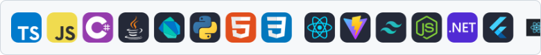

# Justine A. Acuña

**Junior Full-Stack Developer**  
Legazpi, Albay, Philippines  
BS Information Technology, STI College Legazpi (expected June 2027)

## About me

I build web and mobile applications that help people move through multi-step workflows. I work across the screens people use, the APIs that connect them, and the databases that keep records consistent. I primarily work with TypeScript and C#, and I enjoy making complex processes easier to follow. As the project lead on ALEConnect, I helped design how consumer reports move from a mobile app to utility staff and field crews. In Dermedicare, I integrated a sandbox payment flow and worked on doctor scheduling. I want to grow as a full-stack software engineer, with a focus on reliable APIs, mobile usability, and secure payment integrations.

## Tech stack

  
Tech stack marquee

  

**Working strengths:** Project leadership, workflow design across user roles, and coordinating student organizations.

## Selected projects

### ALEConnect (Electric utility reporting and dispatch)

**Project lead and full-stack developer (capstone)**

Consumers can submit and track electricity service reports. Staff can review those reports, group them into incidents, coordinate field work, and publish advisories.

I designed six core workflows and built REST APIs, access controls, and database transactions. The project demonstrates how I connect mobile interfaces, staff tools, and backend services using React, Expo, TypeScript, Node.js, MySQL, and Cloudflare.

[Consumer mobile source code](https://github.com/aymkopi/aleconnect-mobile)

[Staff sign-in](https://aleconnect.app/)

### Dermedicare (Clinic appointment and management system)

**Full-stack developer (academic project)**

The clinic portal brings appointment booking, doctor scheduling, and staff operations into one web application. I built recurring schedules and conflict checks and integrated Maya Checkout in its sandbox. The app opens a hosted checkout session and records the mock payment outcome from a webhook.

**Skills demonstrated:** C#, .NET 9, Blazor, MongoDB, availability checks, and payment integration.

[Source code](https://github.com/aymkopi/DermedicareMain)

### HH Production (Booking and management system)

**Desktop application developer (academic project)**

The Windows app brings bookings, client records, service packages, pricing, and revenue reporting together. I built the interface and connected it to SQL Server so staff could validate bookings and review revenue in the same application.

**Skills demonstrated:** C#, .NET, Windows Forms, SQL Server, and booking validation.

[Source code](https://github.com/aymkopi/IPSys)

**More work:** [CampusConnect](https://github.com/aymkopi/CampusConnect), a Java Swing and MySQL desktop app for managing campus organizations, events, and records.

## Leadership experience

- **Technology Office Head**, Microsoft Student Community Club, STI College Legazpi (2026–2027)
- **Senior Councilor**, College Student Council, STI College Legazpi (2026–2027). Previously served as Treasurer and IT Representative.
- **President**, Society of Information Technology Students (SITeS), STI College Legazpi (2025–2026)

## Education and training

- **BS Information Technology**, STI College Legazpi (expected June 2027). Coursework includes data structures, object-oriented programming, application development, and integrative programming.
- **Java Fundamentals**, Oracle Academy (2024). Completed 90 hours of training in object-oriented programming and applied Java exercises.

## Contact

[Connect with me on LinkedIn](https://www.linkedin.com/in/aymkopi/)
